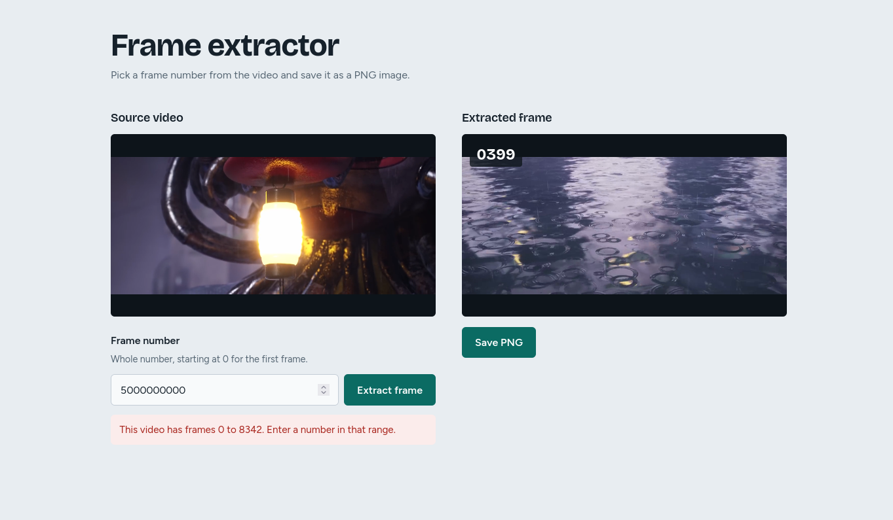

# About this project

This project was developed for study purposes. I created a simple frame extractor to demonstrate my understanding and experience with FFmpeg and PHP.

The goal is not to achieve the greatest security and scalability, it's simply to study and serve as a portfolio of my skills with video technologies.

### AI Usage Disclaimer

The project was developed by me entirely at first without the use of AI. 

After I finished the case study, I asked claude to improve my frontend. And that's the only part where I used AI on this specific project.


## How to run this project?
First run the command 
``` 
php artisan serve
```
Then access the url given (example: localhost:8000/video)

